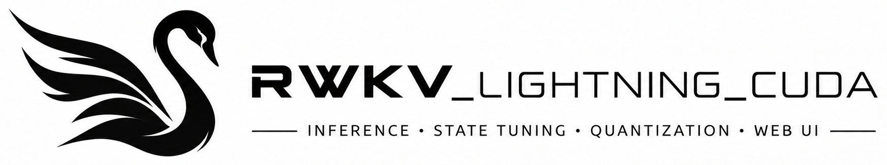

<div align="center">
  

  [](https://github.com/Alic-Li/rwkv_lightning_cuda/actions/workflows/ci.yml)
  
  
  
  [](https://github.com/Alic-Li/rwkv_lightning_cuda/releases)
</div>

# RWKV Lightning CUDA

[中文说明](README_zh.md)
[知乎文章](https://zhuanlan.zhihu.com/p/2084593015339991309)

High-performance RWKV-7 inference server for NVIDIA CUDA GPUs, with an AMD HIP
fallback path. It ships OpenAI-style and native batch APIs with streaming SSE,
an L1/L2/SQLite session state cache, W8A16/W4A16 quantized serving, standalone
state tuning, a multi-backend Go router, and a Go desktop launcher with a Web UI.

- **Fast prefill and decode** — chunked prefill with VRAM-adaptive admission control, SSE streaming with configurable chunk size.
- **Session state cache** — reuse conversation states across L1 VRAM, L2 RAM, and SQLite persistence; uploaded `.pth` states work with every generation endpoint.
- **Quantization** — W4A16/W8A16 `.rwkvq` checkpoints with packed INT4/INT8 weights on device.
- **State tuning** — train `time_state` blocks standalone from JSONL data without touching linear weights.
- **MiSS adapters&peft** — train one compact `D` matrix per target linear, then load adapters per request without modifying shared model weights.
- **Batteries included** — weighted least-inflight load-balancing router and a desktop launcher with Web UI.

Both training binaries use the independent [BF16 training backbone](src/training/README.md), with streamed base loading, native state passing and BF16 exports. Inference keeps its existing FP16/quantized paths.

[NoRA-init tuning](src/nora/README.md) adds `rwkv_nora_tune` and `rwkv_nora_tune_server`, with random column-normalized A, trainable A/B, fixed `alpha/rank=1`, and dynamic adapter loading in the inference engine.

The standalone `rwkv_miss_tune_server`, `rwkv_state_tune_server` and `rwkv_nora_tune_server` add persistent BF16 online RL (MiSS, State and NoRA modes, GRPO or Dr.GRPO advantages): batch rollouts, signed-advantage train steps, versioned actor snapshots, and shared prefix caching. See the [online RL guide](docs/online-rl.md).

## Benchmark

Inference performance comparison between **RWKV_Lightning_CUDA** and [irwkv](https://github.com/rwkv-org/irwkv/commit/1f0bd68709f11219669550903a6bcb63dd6be256):

- **Hardware**: NVIDIA RTX PRO 6000 Blackwell (96 GB VRAM)
- **Model**: RWKV-7 7.2B

| Batch Size / Concurrency | RWKV_Lightning_CUDA E2E Latency | irwkv E2E Latency | RWKV_Lightning_CUDA TTFT | irwkv TTFT | RWKV_Lightning_CUDA Throughput | irwkv Throughput | Speedup |
| :---: | :---: | :---: | :---: | :---: | :---: | :---: | :---: |
| **1** | **0.461s** | 0.672s | **3.8ms** | 16.2ms | **138.7 tok/s** | 95.2 tok/s | **+45.7%** |
| **8** | **0.537s** | 0.698s | **10.6ms** | 35.7ms | **953.5 tok/s** | 733.5 tok/s | **+30.0%** |
| **16** | **0.685s** | 0.737s | **17.7ms** | 44.4ms | **1,494.1 tok/s** | 1,389.6 tok/s | **+7.5%** |
| **32** | **0.732s** | 0.756s | **35.7ms** | 62.1ms | **2,796.2 tok/s** | 2,707.4 tok/s | **+3.3%** |
| **64** | **0.810s** | 0.869s | **60.1ms** | 99.6ms | **5,055.6 tok/s** | 4,714.6 tok/s | **+7.2%** |
| **128** | **1.033s** | 1.111s | **119.9ms** | 173.1ms | **7,930.6 tok/s** | 7,375.4 tok/s | **+7.5%** |
| **256** | **1.504s** | 1.936s | **258.7ms** | 294.8ms | **10,890.3 tok/s** | 8,461.7 tok/s | **+28.7%** |

*Note: Peak decode speed of RWKV_Lightning_CUDA reaches **12,896 tokens/s** at batch size 256 with only ~14.2 GB VRAM footprint (compared to irwkv's ~66.2 GB allocation).*

## Quick Start

For Ubuntu 24.04 LTS，Use the following command to install the dependencies:
```bash
sudo apt install -y libpq-dev libmariadb-dev libjsoncpp-dev uuid-dev zlib1g-dev libssl-dev libsqlite3-dev libbrotli-dev libhiredis-dev libyaml-cpp-dev libnccl2 libnccl-dev
```
Than install Drogon
```bash
git clone --branch v1.9.14 --recurse-submodules \
  https://github.com/drogonframework/drogon.git \
  drogon-1.9.14-git
mkdir build
cd build
cmake ..
make -j && sudo make install
```
```bash
cmake -S . -B ./build -DCMAKE_BUILD_TYPE=Release -DCMAKE_CUDA_ARCHITECTURES="75;80;86;87;89;90;100;120"
cmake --build ./build -j --config Release --target bundle_all

./build/bundle/rwkv_lighting_cuda \
  --model-path /path/to/model.pth \
  --vocab-path ./assets/rwkv_vocab_v20230424.txt \
  --host 127.0.0.1 \
  --port 8000
```

Verify the server is up:

```bash
curl -sS "http://127.0.0.1:8000/v1/server/status"
```

All build variants (Windows, AMD ROCm, the quantization tool, the Go launcher)
are described in the [build guide](docs/build.md).

## Documentation

| Guide | Description |
|---|---|
| [Build](docs/build.md) | CMake build for CUDA and ROCm, W8A16/W4A16 quantization tool, Go launcher; step-by-step [Windows guide](docs/windows-build-run.md) |
| [Run](docs/run.md) | Server flags, Windows runtime, dynamic model loading, standalone state tuning |
| [HTTP API](docs/http-api.md) | curl examples for every endpoint; complete reference in [rwkv_lightning_api_doc.md](rwkv_lightning_api_doc.md) |
| [Launcher integration (Chinese)](RWKV_Lightning_CUDA_Launcher/docs/integration-guide.md) | Client / Agent, control APIs, authentication and multi-backend integration |
| [MiSS adapters&peft](src/miss/README.md) | Frozen-base adapter training, checkpoint/resume, export, dynamic serving, caches, and validation |
| [State tuning](src/state_tuning/README.md) | Standalone `time_state` training and checkpoint format |
| [Router](RWKV_Lightning_CUDA_router/README.md) | Multi-backend load-balancing reverse proxy with session affinity and state fan-out |
| [Releasing](docs/releasing.md) | CI packaging matrix and how to publish a versioned release |

## CI / Release

GitHub Actions builds Linux and Windows CUDA packages on PRs and `main` against
a CUDA 12.9 / 13.2 matrix. Bump the root [`VERSION`](VERSION) file on `main` to
publish a new Release with Linux/Windows binaries and SHA-256 checksums; see
[the release guide](docs/releasing.md) for the workflow.

## Project layout

- `include/rwkv/`: public headers grouped into `common`, `io`, `runtime`, `inference`, and `server` APIs.
- `src/backend/`: GPU model backend integration.
- `src/inference/`: tokenization, sampling, and generation orchestration.
- `src/io/`: PTH archive and tensor readers.
- `src/server/`: HTTP API, model routing, admission control, and state storage.
- `src/app/`: executable entry points.
- `assets/`: runtime data files such as the tokenizer vocabulary, plus the README banner image.
- `cmake/`: dependency, compiler-option, and packaging modules.

The root `CMakeLists.txt` only selects the GPU backend and composes these modules. Target definitions live next to their corresponding source trees in `src/CMakeLists.txt`, `tools/CMakeLists.txt`, and `test/CMakeLists.txt`.

## Continuous batching

The server merges concurrent requests into one persistent GPU decode scheduler, with independent row sampling; base and MiSS/NoRA adapter rows share one batch. `--decode-batch-size` caps active decode rows (default 64); `--chunk-size` controls interleaved prefill chunks. See the [scheduler notes](docs/continuous-batching.zh-CN.md) and [`tools/bench_continuous_http.py`](tools/bench_continuous_http.py) for configuration and benchmarking.
