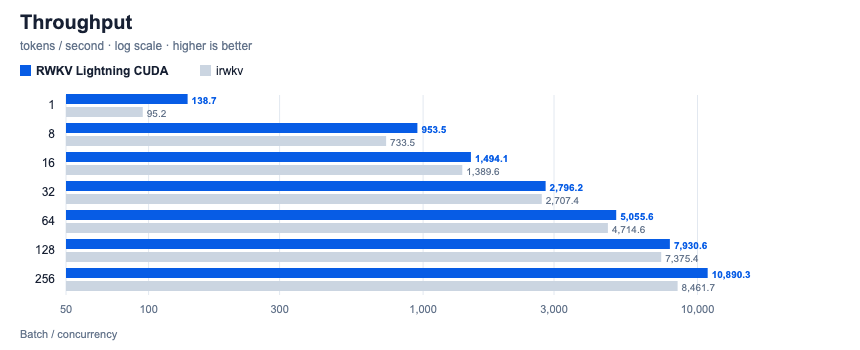
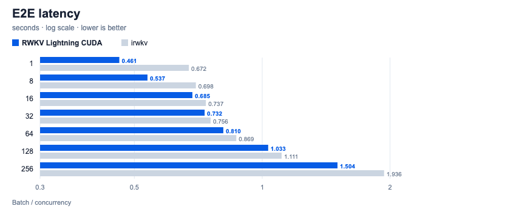
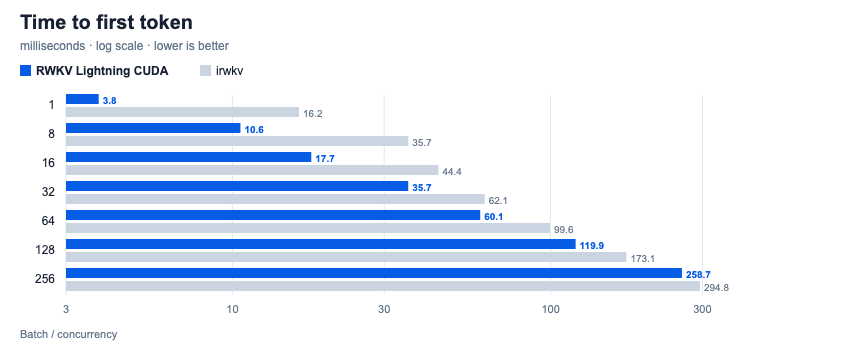

# Benchmark

[中文](benchmark.zh-CN.md)

All numbers come from the scripts in [`test/benchmark/src`](../test/benchmark/src):
the same prompt (`"User: Please describe the history and development of
artificial intelligence in brief.\nAssistant:"`), `max_tokens=64`, best run per
batch size. Raw results are in [`test/benchmark/result`](../test/benchmark/result).

| Column | Meaning |
| --- | --- |
| E2E latency | Wall time of one non-streaming `/v1/batch/completions` request |
| TTFT | Time to the first SSE chunk of the same request in streaming mode |
| Throughput | Generated tokens / E2E wall time |
| Decode | Decode-only speed reported by `/v1/server/status` |

## RTX PRO 6000 Blackwell vs irwkv

RWKV_Lightning_CUDA compared with
[irwkv](https://github.com/rwkv-org/irwkv/commit/1f0bd68709f11219669550903a6bcb63dd6be256):

- **Hardware**: NVIDIA RTX PRO 6000 Blackwell (96 GB VRAM)
- **Model**: RWKV-7 7.2B, BF16 weights
- **Scripts**: `benchmark_8060.py` (CUDA), `benchmark_8059.py` (irwkv)

| Batch / Concurrency | E2E latency (s) ↓ CUDA / irwkv | TTFT (ms) ↓ CUDA / irwkv | Throughput (tok/s) ↑ CUDA / irwkv | Throughput gain ↑ |
| ---: | ---: | ---: | ---: | ---: |
| 1 | **0.461** / 0.672 | **3.8** / 16.2 | **138.7** / 95.2 | **+45.7%** |
| 8 | **0.537** / 0.698 | **10.6** / 35.7 | **953.5** / 733.5 | **+30.0%** |
| 16 | **0.685** / 0.737 | **17.7** / 44.4 | **1,494.1** / 1,389.6 | **+7.5%** |
| 32 | **0.732** / 0.756 | **35.7** / 62.1 | **2,796.2** / 2,707.4 | **+3.3%** |
| 64 | **0.810** / 0.869 | **60.1** / 99.6 | **5,055.6** / 4,714.6 | **+7.2%** |
| 128 | **1.033** / 1.111 | **119.9** / 173.1 | **7,930.6** / 7,375.4 | **+7.5%** |
| 256 | **1.504** / 1.936 | **258.7** / 294.8 | **10,890.3** / 8,461.7 | **+28.7%** |

*Peak decode speed reaches **12,896 tokens/s** at batch size 256 with only
~14.2 GB VRAM footprint (irwkv allocates ~66.2 GB).*

## RTX 4060 Ti 16 GB (mainstream card reference)

A consumer-card reference point with the same model and scripts.

- **Hardware**: NVIDIA GeForce RTX 4060 Ti 16 GB (128-bit, 288 GB/s), default
  165 W power limit, driver 615.78.08. SM ran at ~2.8 GHz, memory at 8751 MHz.
- **⚠️ Unlocked compute**: this card runs the
  [gpu-unlock-ada](https://github.com/JustAResearcher/gpu-unlock-ada) kernel
  module (`gpu_unlock` loaded). A stock 4060 Ti may be slower; do not compare
  these numbers with stock cards without saying so.
- **Software**: release `v1.8.12` (`linux-x64-cuda13.2`), server started with
  `--decode-batch-size 256`, other flags default.
- **Model**: RWKV-7 7.2B (`rwkv7-g1l-7.2b-20261031`)

### BF16 (same config as the PRO 6000 run)

BF16 weights use 14.2 GB, so only ~1.5 GB is left for prefill buffers and one
batch request is capped at **bsz 16**.

| Batch | E2E latency (s) | Throughput (tok/s) | Decode (tok/s) | vs PRO 6000 |
| ---: | ---: | ---: | ---: | ---: |
| 1 | 2.440 | 26.2 | 26.3 | 18.9% |
| 8 | 2.806 | 182.5 | 183.7 | 19.1% |
| 16 | 3.637 | 281.5 | 284.3 | 18.8% |

TTFT was not measured: on v1.8.12 a bsz 17–22 request hung forever (see the
prefill admission fix in the same change), which stopped the script before
its streaming step.

### W8A16 (recommended on 16 GB)

These are historical RTX 4060 Ti measurements. The current three-format comparison is maintained in the [unified quantization report](../quant/VALIDATION.zh-CN.md).

`rwkv_quantize --format w8a16` shrinks the weights to 7.7 GB (7.8 GB resident),
which lifts one batch request to **bsz 138** and nearly doubles single-row
decode, since decode is bandwidth bound on this card.

| Batch | E2E latency (s) | TTFT (ms) | Throughput (tok/s) | Decode (tok/s) | vs PRO 6000 BF16 |
| ---: | ---: | ---: | ---: | ---: | ---: |
| 1 | 1.330 | 4.3 | 48.1 | 48.3 | 34.7% |
| 8 | 1.597 | 17.6 | 320.6 | 324.6 | 33.6% |
| 16 | 1.858 | 32.8 | 551.2 | 561.9 | 36.9% |
| 32 | 2.267 | 62.6 | 903.5 | 929.6 | 32.3% |
| 64 | 2.734 | 121.3 | 1,498.1 | 1,564.9 | 29.6% |
| 128 | 4.038 | 240.3 | 2,028.6 | 2,147.7 | 25.6% |

bsz 256 exceeds the per-request limit and is rejected.

Concurrent single-row requests (`benchmark_8060_concurrent.py`):

| Concurrency | `/v1/batch/completions` (tok/s) | P50 / P90 latency (s) | `/v1/chat/completions` (tok/s) | P90 latency (s) |
| ---: | ---: | ---: | ---: | ---: |
| 1 | 47.7 | 1.34 / 1.34 | 47.1 | 1.36 |
| 8 | 306.5 | 1.67 / 1.67 | 295.6 | 1.73 |
| 16 | 529.5 | 1.93 / 1.93 | 504.8 | 2.03 |
| 32 | 871.7 | 2.33 / 2.35 | 808.1 | 2.53 |
| 64 | 1,459.4 | 2.77 / 2.79 | 1,283.2 | 3.19 |
| 128 | 1,414.5 | 3.94 / 4.07 | 1,213.5 | 6.71 |
| 256 | 1,605.2 | 7.66 / 10.17 | 1,396.4 | 11.66 |

All 256 concurrent requests succeed, but throughput stops scaling past 64:
prefill admission only reserves VRAM for ~95 rows at a time, so the rest
queue. On this card VRAM, not compute, is the limit.

Raw data: [`test/benchmark/result/rtx4060ti`](../test/benchmark/result/rtx4060ti).
