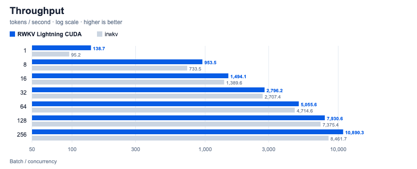
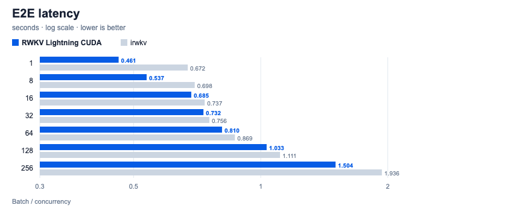
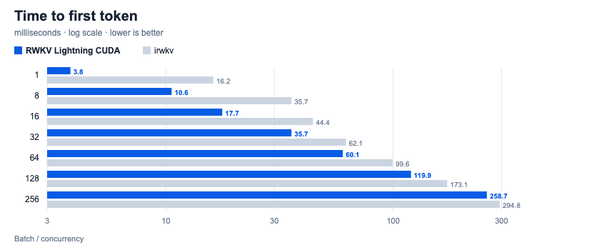

# 性能评测 (Benchmark)

[English](benchmark.md)

所有数据都来自 [`test/benchmark/src`](../test/benchmark/src) 下的脚本：同一个
prompt（`"User: Please describe the history and development of artificial
intelligence in brief.\nAssistant:"`），`max_tokens=64`，每个批大小取最好的一轮。
原始结果见 [`test/benchmark/result`](../test/benchmark/result)。

| 列 | 含义 |
| --- | --- |
| 端到端延迟 | 一次非流式 `/v1/batch/completions` 请求的总耗时 |
| TTFT | 同一请求以流式发送时，收到第一个 SSE 分块的时间 |
| 吞吐 | 生成 token 数 / 端到端耗时 |
| Decode | `/v1/server/status` 报告的纯 decode 速度 |

## RTX PRO 6000 Blackwell 对比 irwkv

**RWKV_Lightning_CUDA** 与
[irwkv](https://github.com/rwkv-org/irwkv/commit/1f0bd68709f11219669550903a6bcb63dd6be256)
在不同并发/批大小下的推理性能对比：

- **测试硬件**：NVIDIA RTX PRO 6000 Blackwell（96 GB VRAM）
- **模型规格**：RWKV-7 7.2B，BF16 权重
- **脚本**：`benchmark_8060.py`（CUDA）、`benchmark_8059.py`（irwkv）

| Batch / Concurrency | E2E latency (s) ↓ CUDA / irwkv | TTFT (ms) ↓ CUDA / irwkv | Throughput (tok/s) ↑ CUDA / irwkv | Throughput gain ↑ |
| ---: | ---: | ---: | ---: | ---: |
| 1 | **0.461** / 0.672 | **3.8** / 16.2 | **138.7** / 95.2 | **+45.7%** |
| 8 | **0.537** / 0.698 | **10.6** / 35.7 | **953.5** / 733.5 | **+30.0%** |
| 16 | **0.685** / 0.737 | **17.7** / 44.4 | **1,494.1** / 1,389.6 | **+7.5%** |
| 32 | **0.732** / 0.756 | **35.7** / 62.1 | **2,796.2** / 2,707.4 | **+3.3%** |
| 64 | **0.810** / 0.869 | **60.1** / 99.6 | **5,055.6** / 4,714.6 | **+7.2%** |
| 128 | **1.033** / 1.111 | **119.9** / 173.1 | **7,930.6** / 7,375.4 | **+7.5%** |
| 256 | **1.504** / 1.936 | **258.7** / 294.8 | **10,890.3** / 8,461.7 | **+28.7%** |

*注：在 bsz=256 时，RWKV_Lightning_CUDA 的纯 Decode 速度高达 **12,896 tokens/s**，
常驻显存仅约 14.2 GB（对比 irwkv 需预分配约 66.2 GB 显存）。*

## RTX 4060 Ti 16 GB（甜品卡参考）

同一模型、同一套脚本在消费级显卡上的参考成绩。

- **测试硬件**：NVIDIA GeForce RTX 4060 Ti 16 GB（128-bit，288 GB/s），默认
  165 W 功耗墙，驱动 615.78.08。跑分时 SM 约 2.8 GHz，显存 8751 MHz。
- **⚠️ 算力已解锁**：这张卡加载了
  [gpu-unlock-ada](https://github.com/JustAResearcher/gpu-unlock-ada) 内核模块
  （`gpu_unlock`）。未解锁的 4060 Ti 可能更慢，和原版卡对比时请注明。
- **软件**：Release `v1.8.12`（`linux-x64-cuda13.2`），服务以
  `--decode-batch-size 256` 启动，其余参数默认。
- **模型**：RWKV-7 7.2B（`rwkv7-g1l-7.2b-20261031`）

### BF16（与 PRO 6000 相同配置）

BF16 权重占 14.2 GB，留给 prefill 缓冲的只有约 1.5 GB，单个 batch 请求上限
**bsz 16**。

| Batch | 端到端延迟 (s) | 吞吐 (tok/s) | Decode (tok/s) | 相当于 PRO 6000 |
| ---: | ---: | ---: | ---: | ---: |
| 1 | 2.440 | 26.2 | 26.3 | 18.9% |
| 8 | 2.806 | 182.5 | 183.7 | 19.1% |
| 16 | 3.637 | 281.5 | 284.3 | 18.8% |

未测 TTFT：v1.8.12 上 bsz 17–22 的请求会永久挂起（见同一变更中的 prefill
准入修复），脚本在流式测试之前就中断了。

### W8A16（16 GB 卡推荐配置）

`rwkv_quantize --format w8a16` 把权重压到 7.7 GB（常驻 7.8 GB），单个 batch
请求上限提高到 **bsz 138**；这张卡的 decode 受显存带宽限制，单路速度也接近翻倍。

| Batch | 端到端延迟 (s) | TTFT (ms) | 吞吐 (tok/s) | Decode (tok/s) | 相当于 PRO 6000 BF16 |
| ---: | ---: | ---: | ---: | ---: | ---: |
| 1 | 1.330 | 4.3 | 48.1 | 48.3 | 34.7% |
| 8 | 1.597 | 17.6 | 320.6 | 324.6 | 33.6% |
| 16 | 1.858 | 32.8 | 551.2 | 561.9 | 36.9% |
| 32 | 2.267 | 62.6 | 903.5 | 929.6 | 32.3% |
| 64 | 2.734 | 121.3 | 1,498.1 | 1,564.9 | 29.6% |
| 128 | 4.038 | 240.3 | 2,028.6 | 2,147.7 | 25.6% |

bsz 256 超过单请求上限，会被拒绝。

并发单条请求（`benchmark_8060_concurrent.py`）：

| 并发数 | `/v1/batch/completions` (tok/s) | P50 / P90 延迟 (s) | `/v1/chat/completions` (tok/s) | P90 延迟 (s) |
| ---: | ---: | ---: | ---: | ---: |
| 1 | 47.7 | 1.34 / 1.34 | 47.1 | 1.36 |
| 8 | 306.5 | 1.67 / 1.67 | 295.6 | 1.73 |
| 16 | 529.5 | 1.93 / 1.93 | 504.8 | 2.03 |
| 32 | 871.7 | 2.33 / 2.35 | 808.1 | 2.53 |
| 64 | 1,459.4 | 2.77 / 2.79 | 1,283.2 | 3.19 |
| 128 | 1,414.5 | 3.94 / 4.07 | 1,213.5 | 6.71 |
| 256 | 1,605.2 | 7.66 / 10.17 | 1,396.4 | 11.66 |

256 并发全部成功，但并发超过 64 后吞吐不再增长：prefill 准入同时只能给约
95 行预留显存，其余请求排队。这张卡的瓶颈是显存，不是算力。

原始数据：[`test/benchmark/result/rtx4060ti`](../test/benchmark/result/rtx4060ti)。
