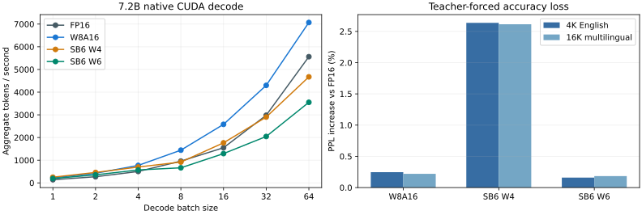

# W8A16、SB6 W4/W6 统一验证报告

日期：2026-11-14。清理后的原生 CUDA 后端，使用用户指定的 7.2B 权重重新测量。旧实验报告由本文替代。

## 结论

本机单路解码以 SB6 W4 最快、占用最小，代价是约 2.6% 的 PPL 增幅；SB6 W6 在这两段固定文本上的 PPL 损失略小于 W8，但速度更慢。W8 在 batch ≥4 的解码中表现最好；FP16 的长预填充最快。SB6 当前适合压缩模型和低并发解码，并非所有推理形状都会加速。

| 方案 | 文件 GiB | 加载权重显存 MiB | B1 解码 token/s | 1024-token 预填充 ms | 4K PPL 增幅 | 16K PPL 增幅 |
|---|---:|---:|---:|---:|---:|---:|
| FP16 | 13.411 | 13,634 | 141.23 | 56.529 | 基线 | 基线 |
| W8A16 | 7.163 | 7,237 | 225.36 | 74.737 | +0.246% | +0.220% |
| SB6 W4 | 4.449 | 4,856 | 251.99 | 126.295 | +2.637% | +2.615% |
| SB6 W6 | 5.989 | 6,434 | 194.19 | 158.141 | +0.159% | +0.183% |

文件大小包含全部张量；FP16 行对应来源 BF16 PTH 的文件大小，运行时转换为 FP16。显存是加载器统计的权重缓冲区，不是进程峰值；各方案另有 512 MiB CPU embedding、循环状态、激活和工作区。SB6 W4/W6 对齐量化矩阵的磁盘开销为 4.5/6.5 bpw，加载后为 5/7 bpw。



## 模型与测量条件

- 来源：`/mnt/nvme0n1/no22/rwkv7-g1l-7.2b-20261031-ctx34304.pth`；32 层、C=4096、FFN=16384、词表 65536。
- GPU：NVIDIA RTX PRO 6000 Blackwell Workstation Edition，97,887 MiB；驱动 615.78.08。CUDA 版本、二进制及源码 SHA256 见 [results.json](validation/results.json)。
- 原生 C++ CUDA 推理：FP16 权重/激活、FP32 WKV 状态，`cmix-sparse=no-fc`。W8 使用原有逐行量化和调优缓存，未修改 W8 CUDA 算子。
- SB6 使用 AW/加权最小二乘，16×256 校准 token、batch=4、seed=42。W4 的 192 个投影量化，layer 0 attention output 保留 BF16；W6 量化全部 193 个目标投影。Embedding、归一化和低秩张量保持浮点。
- 测量时保留原有在线服务，约占 16.3 GiB 显存；开测 GPU 利用率为 0%。测试进程顺序运行，性能测试期间未同时运行校准、精度测试或其他本任务 GPU 作业。未锁频，因此结果含正常时钟/调度波动。

## 性能

使用 `rwkv_model_bench`，固定随机种子 1380668983；32-token 初始 prefill、每点 3 次预热、10 次采样取中位数，再轮换模型顺序执行 3 轮，报告三轮中位数。后端在返回前同步 CUDA stream，计时包含完整前向调用，不是仅计 kernel 提交。排除模型加载、W8 调优、HTTP、tokenizer 和采样。输入为固定随机 token，不代表具体应用请求。

解码延续同一状态；各轮各 batch 从零状态开始并执行相同预热流程。吞吐为整个 batch 的总 token/s。原始每轮延迟在 [results.json](validation/results.json)，整表见 [performance.csv](validation/performance.csv)。

| Batch | FP16 token/s | W8 token/s | SB6 W4 token/s | SB6 W6 token/s |
|---:|---:|---:|---:|---:|
| 1 | 141.23 | 225.36 | 251.99 | 194.19 |
| 2 | 271.58 | 424.40 | 460.59 | 356.14 |
| 4 | 504.42 | 771.71 | 700.59 | 571.52 |
| 8 | 960.63 | 1443.19 | 919.53 | 665.34 |
| 16 | 1549.85 | 2580.82 | 1766.28 | 1291.93 |
| 32 | 2981.13 | 4298.10 | 2901.13 | 2045.76 |
| 64 | 5561.54 | 7069.60 | 4673.58 | 3551.83 |

预填充为 B=1、一次 `forward_prefill` 输入整段 token，连续预热/采样沿用状态；长度不是 HTTP 分块大小。以下是同步延迟，越低越好。

| 输入 token | FP16 ms | W8 ms | SB6 W4 ms | SB6 W6 ms |
|---:|---:|---:|---:|---:|
| 128 | 12.948 | 12.574 | 17.907 | 23.244 |
| 512 | 31.115 | 38.486 | 63.314 | 79.545 |
| 1024 | 56.529 | 74.737 | 126.295 | 158.141 |

SB6 的高位读取、参数展开与分组计算影响实际吞吐；压缩位数不能直接推导速度。本轮未继续改变算子调度，以便保持三个方案的清晰基线。

## 精度损失

使用 `rwkv_logit_mse_curve` 对固定真实 token 做 teacher forcing，从零状态连续推理。每段文本的所有候选共享同一份 FP16 logits，并另跑一遍 FP16 估计基线波动；不使用自由生成文本的一致率衡量质量。

- English：4,096 个 next-token 预测；Multilingual：16,384 个预测。每个序列额外读取一个目标 token，RMSE/top-1 也只统计对应的预测位置。
- 4K 是 16K 文本的前缀，二者并非独立样本。长文本由保留的多语种 held-out 窗口拼接而成，跨窗口持续携带状态。它们是回归样本，不是标准任务榜单。
- 与 49,020-token 校准全文比较，两个评测序列均无相同连续 16-token 片段。检查结果、文件 SHA256 和上游参考 commit 见机器可读数据。
- PPL 对所有 token 的 NLL 取均值再指数化；128-token 报告块不重置状态，不对块 PPL 做算术平均。RMSE 为全部预测位置和词表的均方误差开根，top-1 是相对 FP16 的 argmax 一致率。

| 序列 | 方案 | PPL | 相对 FP16 | Logit RMSE | Top-1 一致率 |
|---|---|---:|---:|---:|---:|
| 4K English | FP16 基线 | 7.114895 | — | — | — |
| 4K English | FP16 重跑 | 7.115122 | +0.0032% | 0.01915 | 99.731% |
| 4K English | W8A16 | 7.132429 | +0.2464% | 0.12167 | 97.754% |
| 4K English | SB6 W4 | 7.302516 | +2.6370% | 0.46988 | 91.479% |
| 4K English | SB6 W6 | 7.126211 | +0.1591% | 0.12374 | 98.022% |
| 16K Multilingual | FP16 基线 | 5.821123 | — | — | — |
| 16K Multilingual | FP16 重跑 | 5.820610 | -0.0088% | 0.01962 | 99.719% |
| 16K Multilingual | W8A16 | 5.833934 | +0.2201% | 0.13116 | 97.961% |
| 16K Multilingual | SB6 W4 | 5.973329 | +2.6147% | 0.47857 | 92.291% |
| 16K Multilingual | SB6 W6 | 5.831783 | +0.1831% | 0.12558 | 98.029% |

SB6 W6 的本轮 PPL 略优于 W8，不代表在所有任务上更准确；W4 的约 2.6% PPL 增幅也不能换算成 2.6% 的任务正确率下降。这里只覆盖这一模型的 4K/16K 回归文本，未测 34K 全上下文或下游任务。详见 [accuracy.csv](validation/accuracy.csv)。

## 清理结果与支持范围

- 保留原始 W8A16、SB6 W4、SB6 W6 和 FP16 基线；删除旧对称 W4 G32/G128、SB6 W5、Autopick、GPTQ 的实现、入口、测试目标、旧报告及性能数据。AW 统计收集与 SB6 参数搜索继续保留。
- dtype 3/5 明确拒绝，不复用旧编号。旧模型必须从源 PTH 重新导出；原始 W8 文件继续兼容。
- Launcher 的类型、表单、默认值、API 参数和导出流程已同步，只能提交三个保留格式；SB6 需提供离线校准 manifest。
- 删除旧实验及过期构建文件共 67,791,229,901 字节，约 **63.14 GiB**。来源 PTH 保持原位，三个最终量化文件及 `.source.json` 经哈希检查后迁入 `artifacts/quantization/models/`。
- `artifacts/quantization/data/` 保存可复用统计和评测数据；`validation/` 保存本轮日志、CSV、调优缓存和运行配置，整个目录不进入 Git。版本化目录只保留本报告及其小型图表/结果数据。
- CUDA 支持全部三个格式；HIP 保留 W8，SB6 明确拒绝。本机没有 ROCm 编译器/AMD GPU，本轮没有验证清理后的 HIP 构建或性能。

## 验证与复现

完整 CUDA Release 构建通过，目标架构为 SM75/80/86/87/89/90/100/120。归档、W8 内核、SB6 内核、非零量化模型的四项 CTest 通过；Python 校准与导出测试通过；Launcher 前端 83 项测试、lint、生产构建和 Go race tests 通过。SB6 memcheck 为 0 errors，racecheck 为 0 errors / 0 warnings；MiSS 适配器在 FP16/W8A16/SB6 W4/SB6 W6 基模上的完整兼容回归通过。检查生成的临时模型与 payload 已删除，日志保存在 `artifacts/quantization/validation/`。

```bash
python tools/validate_quantization.py \
  artifacts/quantization/validation/config.json \
  --output artifacts/quantization/validation --rounds 3
```

该配置提供 `source`、`w8a16`、`sb6_w4`、`sb6_w6`、`english`、`multilingual` 六个文件路径。重新汇总已有结果可用 `--stage summarize`；单独重测用 `--stage performance` 或 `--stage accuracy`。
导出与兼容规则见[量化指南](README.zh-CN.md)，SB6 编码见[格式说明](SB6.md)，统计收集与参数搜索见[校准文档](../tools/calibration/README.md)。
